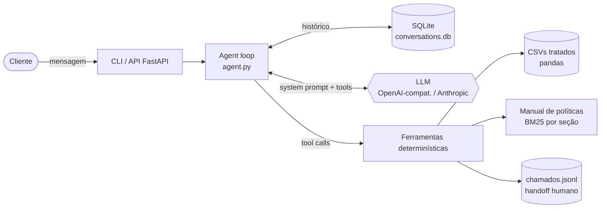

# 🎸 Empório da Música — Agente de Atendimento

Protótipo do agente de atendimento por mensagem de texto da **Empório da Música**, uma loja
fictícia de instrumentos musicais em Campo Grande/MS. Faz parte do desafio técnico de AI Engineer da Artefact.

A assistente virtual se chama **Mel**. Ela responde no tom da loja ("informal mas
profissional", seção 7.1 do manual) e consulta os **dados operacionais** (catálogo,
estoque, promoções, pedidos) e o **manual de políticas** (trocas, frete, pagamento,
horário). Tudo o que é número, prazo ou regra vem de código determinístico, não da
"memória" do modelo.

<sub>Ilustração do fluxo no modo `--debug` (conversas reais em [`examples/`](examples/)):</sub>

```text
você › Quanto custa o Takamine GD20? Dá pra fazer em 12x?
  ⚙ detalhes_produto({"produto": "Takamine GD20"})
  ⚙ calcular_pagamento({"produto": "Takamine GD20"})
Mel  › O *Takamine GD20 Dreadnought Natural* está disponível por *R$ 2.199,00* 🎸
       Dá sim: 12x sem juros de *R$ 183,25*. No PIX sai por *R$ 2.089,05* (5% off).
```

---

## Sumário
1. [Como rodar](#1-como-rodar)
2. [Arquitetura](#2-arquitetura)
3. [Decisões técnicas e justificativas](#3-decisões-técnicas-e-justificativas)
4. [Tratamento dos dados](#4-tratamento-dos-dados)
5. [Qualidade: testes e evals](#5-qualidade-testes-e-evals)
6. [Exemplos de conversa](#6-exemplos-de-conversa)
7. [Suposições](#7-suposições)
8. [Limitações conhecidas e próximos passos](#8-limitações-conhecidas-e-próximos-passos)
9. [Uso de assistentes de código (IA)](#9-uso-de-assistentes-de-código-ia)

---

## 1. Como rodar

**Requisitos:** Python 3.10+ e a chave de um provedor de LLM com *function calling*. O
**Google Gemini tem tier gratuito**, e o Ollama roda local sem chave.

```bash
git clone https://github.com/LaraLibanori/emporio-agent.git
cd emporio-agent
python -m venv .venv && source .venv/bin/activate      # Windows: .venv\Scripts\activate
pip install -e ".[dev,api]"                            # + ",anthropic" nos extras se for usar Claude

cp .env.example .env
# edite .env: LLM_API_KEY (e, se quiser, LLM_MODEL / LLM_BASE_URL)
```

### Provedores suportados (configurados só pelo `.env`)

| Provedor | `LLM_PROVIDER` | `LLM_BASE_URL` | `LLM_MODEL` (sugestão) |
|---|---|---|---|
| Google Gemini (grátis) — **padrão**, API nativa | `gemini` | *(vazio)* | `gemini-3.8-flash` |
| OpenAI | `openai` | *(vazio)* | `gpt-4o-mini` |
| Groq (grátis) | `openai` | `https://api.groq.com/openai/v1` | `llama-3.3-70b-versatile` |
| Ollama (local) | `openai` | `http://localhost:11434/v1` | `qwen2.5:7b-instruct` |
| Anthropic | `anthropic` | — | `claude-haiku-4-5` |

### Interfaces

```bash
# Chat no terminal (persistente). --debug mostra as ferramentas chamadas
python -m emporio --debug
python -m emporio --session 67999990000      # retoma a conversa desse "cliente"

# API HTTP (o formato que um webhook de WhatsApp chamaria)
uvicorn emporio.api:app --reload
curl -X POST localhost:8000/chat -H 'content-type: application/json' \
     -d '{"session_id":"67999990000","message":"Vocês abrem sábado?","debug":true}'
```

### Testes e evals

```bash
pytest                                   # 41 testes, sem rede e sem LLM (~2s)
python evals/run_evals.py                # 10 cenários contra o LLM real -> evals/report.md
python evals/run_evals.py --examples     # também (re)gera as conversas em examples/
```

> **Data simulada:** os pedidos do dataset são de out/2025 a mar/2026, e as regras de
> devolução dependem de prazos. Com `AGENT_NOW=2026-02-20` (no `.env`) dá para "viajar no
> tempo" e demonstrar uma devolução dentro do prazo. Vazio = relógio real de Campo Grande.

---

## 2. Arquitetura



```text
src/emporio/
├── agent.py        # loop de function calling (≈80 linhas), fallback, trace
├── llm.py          # adaptadores: OpenAI-compatível (Gemini/Groq/Ollama/OpenAI) e Anthropic
├── prompts.py      # persona "Mel", regras de ancoragem, roteamento, escopo, LGPD
├── data.py         # carga + limpeza dos CSVs (disponibilidade, promoções, descrições)
├── policies.py     # parsing do PDF por seção + BM25 com expansão de consulta
├── memory.py       # histórico persistente + janela de contexto segura
├── config.py       # .env, fuso de Campo Grande, AGENT_NOW
├── cli.py / api.py # interfaces
└── tools/
    ├── catalog.py  # buscar_produtos, detalhes_produto (fuzzy + alternativas)
    ├── commerce.py # calcular_pagamento (PIX/parcelas), estimar_frete
    ├── orders.py   # consultar_pedido, avaliar_devolucao_ou_troca (com verificação)
    └── store.py    # consultar_politicas, status_loja_agora, registrar_chamado
```

### Ferramentas do agente

| Ferramenta | Quando o modelo usa | O que resolve em código |
|---|---|---|
| `buscar_produtos` | "violões até R$1000", "guitarra Fender" | filtros (categoria, preço promocional, nylon/aço, captação), só itens compráveis, aviso de acessório/categoria vazia |
| `detalhes_produto` | "quanto custa o X", "tem o X?" | match tolerante a erro de digitação, ambiguidade ("Yamaha" → pergunta qual), alternativas se esgotado/descontinuado |
| `calcular_pagamento` | "parcela em 12x?", "quanto no PIX?" | PIX 5% **não cumulativo** com promoção, parcela mínima por faixa, pagamento combinado > R$2.000 |
| `estimar_frete` | "frete pra Dourados?" | regra de Campo Grande (grátis > R$500 / R$35), prazos Correios/Jadlog, grande porte |
| `consultar_pedido` | status, rastreio | **exige nº do pedido + e-mail/telefone do titular**, alerta de atraso |
| `avaliar_devolucao_ou_troca` | arrependimento, troca, defeito | prazos de 7/30/90 dias calculados com datas reais do pedido |
| `consultar_politicas` | endereço, regras, garantia, LGPD | top-3 seções do manual (BM25) |
| `status_loja_agora` | "estão abertos?" | dia, horário e **feriados** (nacionais, MS, Campo Grande, móveis via Páscoa) |
| `registrar_chamado` | reclamação, humano, cancelamento | protocolo + prazo de 24h úteis + quando a equipe volta |

---

## 3. Decisões técnicas e justificativas

### 3.1 Abordagem: *function calling* com ferramentas de domínio (híbrido tools + RAG)
Cada tipo de informação foi para o mecanismo de recuperação que combina com ele:

- **Dados estruturados** (preço, estoque, pedido) → **ferramentas tipadas** sobre pandas.
  Avaliei um *agente de SQL* (text-to-SQL) e descartei por três motivos. Primeiro, ele exporia
  a tabela de clientes a consultas arbitrárias, o que é um risco de LGPD. Segundo, o modelo
  teria de reaprender regras de negócio a cada consulta (status `discontinued` vence
  estoque > 0; promoção só se `is_active`). Terceiro, erros de SQL viram respostas erradas
  ditas com confiança. Ferramentas de domínio pequenas são mais seguras, testáveis e baratas
  em tokens.
- **Texto não estruturado** (manual de políticas) → **RAG** (seção 3.3).
- **Regras com aritmética ou datas** (parcelas, PIX, prazos de devolução, feriados) → **código**.
  LLMs erram contas e esquecem exceções como "PIX não acumula com promoção". O modelo só
  *comunica* o resultado calculado. Isso atende diretamente o manual: *"nunca fornecer
  informações sobre preços, estoque ou prazos sem consultar o sistema"*.

### 3.2 Sem framework de agente (loop próprio)
É um único agente com 9 ferramentas. Um loop explícito em `agent.py` (~80 linhas) deixa
visível tudo o que vai para o modelo, facilita depurar (`--debug` mostra cada chamada) e
testar (`ScriptedLLM` substitui o modelo nos testes). LangChain/LangGraph adicionariam
abstração sem ganho neste escopo. Eu migraria para LangGraph se surgissem múltiplos
agentes, aprovação humana no meio do fluxo ou checkpoints de estado.

### 3.3 RAG das políticas: BM25 por seção (sem embeddings)
- O manual é pequeno (~8 páginas, 26 seções) e usa o mesmo vocabulário do cliente. BM25
  roda **offline, é determinístico, não exige modelo de embedding nem banco vetorial** e é
  trivialmente testável. `test_rag_politicas_recupera_secao_certa` cobre 10 perguntas reais.
- O **chunking é pela estrutura do documento** (seção/subseção, ex.: `4.1 Direito de
  Arrependimento`), não por número fixo de tokens. Assim cada regra fica inteira no mesmo
  trecho e a seção pode ser citada.
- Há **expansão de consulta** com o vocabulário do cliente ("me arrependi", "devolver",
  "estorno" → "devolução arrependimento reembolso") e um *stemming* leve por prefixo.
- *Alternativa considerada:* colocar o manual inteiro no prompt (~3k tokens). Funcionaria
  hoje, mas custa tokens em todo turno e não escala. A interface `PolicyIndex.search` permite
  trocar por busca vetorial/híbrida sem mexer no agente.
- *Híbrido:* o "cartão de visitas" (endereço, telefone, horário) fica fixo no system prompt,
  porque é perguntado o tempo todo e não muda. O resto vem da busca.

### 3.4 Modelo e provedor
- **Padrão: Gemini 3.8 Flash.** Tem bom *function calling*, latência baixa, custo baixo
  e **tier gratuito**, então qualquer avaliador consegue rodar sem cartão de crédito. O
  `gemini-2.5-flash`, planejado originalmente, não está mais disponível para contas novas, e a
  API respondeu com 404 recomendando a troca.
- O formato interno de mensagens é o **chat completions da OpenAI**, que é o padrão de fato. Um
  adaptador cobre OpenAI, Groq, OpenRouter e **Ollama (local, sem dados saindo da máquina)**.
- O **Gemini usa a API nativa** (`generateContent` via HTTP, sem SDK extra). Isso aconteceu
  na prática: a chave do Google usada no desenvolvimento era aceita pela API nativa, mas
  recebia 404 no endpoint compatível com OpenAI. A API nativa também devolve a
  `thoughtSignature` dos *function calls*, que o adaptador preserva no histórico (exigida pelos
  modelos Gemini com raciocínio). A Anthropic tem adaptador próprio. A troca de provedor é só
  configuração.
- Temperatura: o Google recomenda **1.0 para o Gemini 3** (valores baixos podem causar repetição). Para os outros provedores sugiro ~0.2, porque atendimento pede consistência. É configurável em `LLM_TEMPERATURE`.

### 3.5 Estratégia de prompt (`prompts.py`)
O prompt é organizado em blocos com responsabilidades claras:
1. **Persona e tom**, derivados da seção 7.1 (informal-profissional, frases curtas, formato WhatsApp com `*negrito*`, no máximo 1 emoji).
2. **Regra de ouro (ancoragem):** nada de preço, estoque ou prazo sem ferramenta; promoção sempre com preço original + % + preço final; promoção inativa é dita com transparência.
3. **Roteamento explícito:** qual ferramenta para qual intenção, incluindo chamadas paralelas.
4. **Privacidade (LGPD):** verificação antes de qualquer dado de pedido e nada de CPF ou cartão.
5. **Escopo e segurança:** acessórios redirecionados (sem inventar lojas parceiras), assuntos fora da loja recusados com leveza, resistência a *prompt injection* e a descontos não autorizados.

A **data e hora atuais** entram como contexto dinâmico a cada turno, sem ficar no histórico.
As **saídas das ferramentas** já vêm formatadas (R$ 1.234,56, datas dd/mm/aaaa) e trazem
dicas de comportamento (`alerta`, `nota_interna`), o que reduz o trabalho do modelo.

### 3.6 Interface
- **CLI** (rich) para demonstração e desenvolvimento, com `--debug`.
- **API FastAPI** (`POST /chat`), que é o contrato que um webhook de WhatsApp chamaria.
  Mostra o caminho até produção sem precisar de UI.

### 3.7 Persistência do histórico
O atendimento por mensagem é assíncrono: o cliente manda o nº do pedido e volta horas
depois. Por isso cada `session_id` (ex.: telefone) tem o histórico salvo em **SQLite**
(`var/conversations.db`), que não exige infraestrutura. Há uma **janela** das últimas 12
interações, cortada sempre no início de uma mensagem do usuário, para nunca deixar um
resultado de ferramenta órfão (alguns provedores rejeitam isso). Chamados ficam em
`var/chamados.jsonl`.

### 3.8 Robustez
- Uma ferramenta nunca derruba a conversa: argumentos inválidos ou exceções viram `{"erro": ...}` para o modelo se recuperar.
- Se o provedor cair (ou bater rate limit), o cliente recebe uma mensagem amigável com o telefone da loja.
- O loop tem limite de rodadas de ferramenta (evita loops e custo descontrolado).
- Verificação de pedido sem oráculo: "pedido não existe" e "e-mail errado" dão a mesma resposta. As falhas ficam em SQLite e têm dois limites numa janela de 1h: **3 por conversa e 5 por nº de pedido**. Assim, trocar de sessão não libera mais chutes, e um acerto não zera o contador. Ao atingir o limite, o cliente é encaminhado para a equipe.
- Resposta vazia do modelo nunca é gravada no histórico. Na última rodada permitida, o modelo é forçado a responder em texto (`tool_choice=none`), então nenhuma ferramenta executa sem que o cliente veja o resultado.
- As ferramentas aceitam números "humanos" (`"1.000,00"`, `8.0`, `"#8"`) e devolvem erros que o modelo consegue corrigir.

---

## 4. Tratamento dos dados

Antes de codar fiz uma auditoria completa dos CSVs e do PDF. O detalhamento, com a decisão
para cada achado, está em **[`docs/AUDITORIA_DADOS.md`](docs/AUDITORIA_DADOS.md)**. Os
principais pontos:

| Problema encontrado | Tratamento |
|---|---|
| Nos ids 135–144, a descrição contradiz o nome ou as specs ("Music Man Bass 1X" descrito como "Fender Jazz Bass"; "Korg Synth" como "Roland 88 teclas") | Uma heurística de marca/modelo marca essas descrições como **não confiáveis**. O agente usa só nome + specs |
| `discontinued` com estoque 13; `coming_soon` com estoque 2 | O **status vence o estoque**: um campo único `availability` |
| Promoções duplicadas ou inativas | Só vale `is_active=1`, e o preço final é calculado no carregamento |
| E-mail duplicado entre clientes, homônimos | A verificação é por **pedido + contato do titular daquele pedido**, nunca por nome |
| Totais de pedido ≠ soma dos itens (pedidos 3 e 20) | O agente informa o total gravado e não recalcula |
| Telefone e e-mail divergentes dentro do PDF | Uso a versão que aparece mais vezes e é válida; a divergência está documentada |
| Manual diz "300+ instrumentos"; dados têm 65 e 3 categorias vazias | **Os dados mandam**: categoria vazia → "no momento não temos" |
| Erro de digitação em nome ("Cedr"), hífens ("GF-3D" vs "gf3d") | Busca *fuzzy* (rapidfuzz) com chave normalizada e checagem de cobertura dos termos |

---

## 5. Qualidade: testes e evals

**Testes unitários (`pytest`, 41 testes, sem rede):**
- *Ferramentas:* filtros e ordenação, preço promocional, acessório vs "7 cordas", fuzzy e ambiguidade, alternativas, PIX × promoção, parcelas por faixa, frete, verificação de identidade (formatos de telefone, não vazamento, bloqueio), devolução dentro e fora do prazo, garantia, feriados (incluindo Sexta-feira Santa), RAG por seção.
- *Agente (com `ScriptedLLM`):* execução de ferramentas, persistência e isolamento de sessões, ferramenta inexistente, queda do provedor, limite de rodadas, janela de histórico, conversão para o formato Anthropic.

**Evals end-to-end (`evals/run_evals.py`, LLM real):** 10 cenários multi-turno. Cada turno
verifica as **ferramentas chamadas** (e as que *não* podem ser chamadas, ex.: consultar
pedido sem verificação), **regex obrigatórias** (preço correto, protocolo) e **proibidas**
(preço inventado, dado de outro cliente, receita de bolo 🙃). Os cenários cobrem os
exemplos do enunciado, privacidade, prompt injection, produto esgotado, categoria vazia e
frete sem valor inventado. O relatório sai em `evals/report.md`.

---

## 6. Exemplos de conversa

Em [`examples/`](examples/), geradas pelo próprio agente com
`python evals/run_evals.py --examples` (conversas reais, com as ferramentas chamadas em
cada turno):

| Arquivo | Cenário | Não trivial? |
|---|---|---|
| `01_catalogo_violoes.md` | Violões até R$1000, recomendação para iniciante, valor no PIX | consulta de catálogo + cálculo |
| `02_loja_endereco_horario.md` | Endereço e "estão abertos agora?" em pleno feriado de Finados | política + calendário |
| `03_preco_promocao_parcelamento.md` | Preço do Takamine GD20, 12x, promoção ativa vs promoção expirada | ✅ dados em tempo real + regras de promoção |
| `04_devolucao_arrependimento.md` | "Me arrependi": verificação de identidade → prazo de 7 dias → abertura de chamado | ✅ aplicação de política sobre pedido real |
| `05_escopo_e_pedido_atrasado.md` | Cordas/palhetas (fora do catálogo), receita de bolo, pedido com entrega atrasada | ✅ escopo + escalonamento |

---

## 7. Suposições

Seguindo a orientação do enunciado, assumi o seguinte e documentei cada ponto:
1. **Data de recebimento** não existe no dataset. Uso `estimated_delivery` como proxy para os prazos que contam "após o recebimento", e o agente avisa que a equipe confirma a data real.
2. **Todas as vendas são online** para fins do direito de arrependimento (os pedidos têm rastreio e entrega).
3. **Parcelamento:** vale a seção 3.1 (mais específica que a tabela). "Até 3x sem mínimo (exceto abaixo de R$50)" foi lido como parcela mínima de R$50.
4. **Região metropolitana de Campo Grande:** o manual não lista os municípios. Considero só Campo Grande, e o agente orienta o cliente a confirmar se morar em cidade vizinha.
5. **Feriados:** o manual diz "fechado em feriados" sem listar quais. Incluí os nacionais, o estadual (MS, 11/10), os municipais (aniversário de Campo Grande 26/08, Santo Antônio 13/06) e os móveis (Carnaval, Sexta-feira Santa, Corpus Christi).
6. **Cancelamento antes do envio** não está no manual. O agente não promete nada e abre chamado.
7. **Contato oficial:** (67) 3341-4444 e contato@emporiodamusica.com.br (ver auditoria).
8. **Promoções sem data de validade:** `is_active` é a fonte da verdade.

---

## 8. Limitações conhecidas e próximos passos

**Limitações**
- **O handoff humano é um arquivo** (`chamados.jsonl`). Não há integração real com helpdesk ou CRM.
- **A verificação de identidade é simples** (nº do pedido + e-mail/telefone, com limite de tentativas). Em produção usaria OTP via WhatsApp.
- **O `session_id` da API é confiável por design.** O histórico de uma sessão pode conter dados de pedido já verificados, então em produção o id precisa vir de um canal autenticado (o número remetente informado pelo webhook do WhatsApp), nunca do cliente. A API também não tem autenticação própria.
- **A instalação suportada é a editável** (`pip install -e .`): os CSVs e o PDF são lidos de `data/` no repositório (ou de `AGENT_DATA_DIR`).
- **Frete fora de Campo Grande** não é cotado (exige CEP, peso e dimensões que o dataset não tem).
- **O dataset é estático** (CSVs carregados uma vez). Mudanças de estoque exigem reiniciar.
- **Não há reserva de produto nem fechamento de venda**: o agente informa e encaminha.
- **Guardrails só via prompt** e no desenho das ferramentas. Não há moderação dedicada de entrada e saída.
- **O BM25 é léxico**: perguntas com vocabulário muito distante do manual dependem da expansão de consulta.

**Com mais tempo**
1. **Banco real + cache**: Postgres com as tabelas, as ferramentas consultando via repositório, invalidação de cache de estoque.
2. **Integração WhatsApp** (Cloud API) sobre o `/chat`, com respostas automáticas fora do expediente, como pede a seção 7.1.
3. **Observabilidade**: tracing com Langfuse/OpenTelemetry (tokens, latência e ferramentas por turno) e painel de intenções e taxa de escalonamento.
4. **Evals contínuos no CI**: rodar `run_evals.py` a cada PR com um conjunto maior (tirado de conversas reais anonimizadas) e LLM-as-judge para tom de voz.
5. **RAG híbrido** (BM25 + embeddings multilíngues) se o manual crescer, e versionamento das políticas.
6. **Guardrails dedicados**: classificador de intenção e escopo antes do LLM, e checagem pós-resposta de que todo preço citado aparece no resultado de alguma ferramenta.
7. **Recomendação melhor**: perfil do cliente (nível, estilo, orçamento) e histórico de compras.

---

## 9. Uso de assistentes de código (IA)

Usei o **Claude (Anthropic)** como par de programação em modo agêntico, com subagentes,
dentro de um fluxo que eu conduzi:

1. **Auditoria de dados delegada:** um subagente analisou os 6 CSVs e o PDF em paralelo (integridade, totais, contradições entre descrição e specs, divergências no manual). Revisei o relatório e decidi o tratamento de cada item ([`docs/AUDITORIA_DADOS.md`](docs/AUDITORIA_DADOS.md)).
2. **Arquitetura:** discuti as alternativas (agente SQL × ferramentas de domínio; embeddings × BM25; framework × loop próprio) e tomei as decisões descritas na seção 3.
3. **Implementação incremental:** camada de dados → ferramentas (testadas isoladamente contra os dados reais antes de existir o agente) → loop do agente → testes → evals. Cada etapa virou um commit.
4. **Revisão independente:** um segundo subagente, sem participar da escrita, revisou o código como *code reviewer* (bugs de lógica das políticas, casos de borda, vazamento de dados, compatibilidade entre provedores). As correções estão no histórico de commits.
5. **Validação:** todas as regras (parcelas, PIX, prazos, feriados) têm teste com valor esperado calculado à mão a partir do manual.

Usei a IA para acelerar a escrita e ampliar a cobertura de casos de borda. As decisões de
produto e arquitetura, as suposições e a validação final foram minhas.
